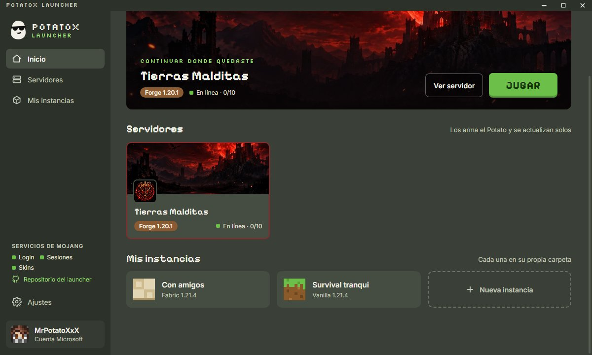
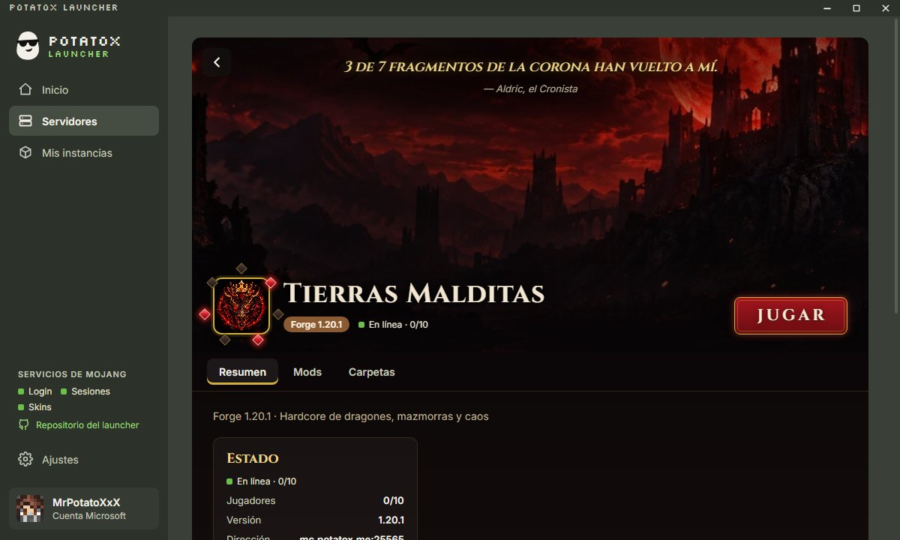
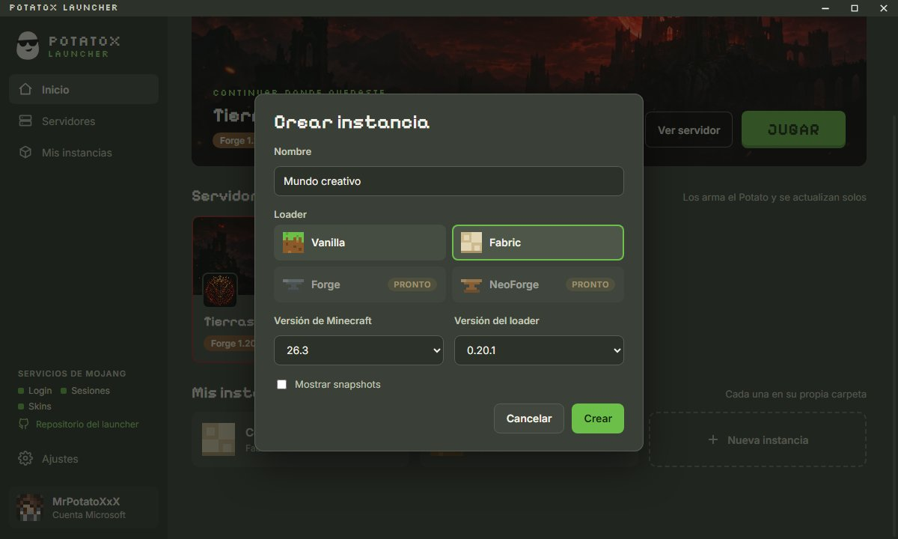
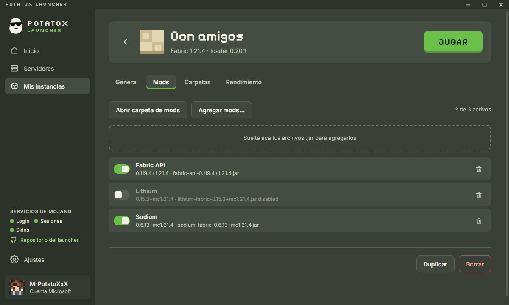
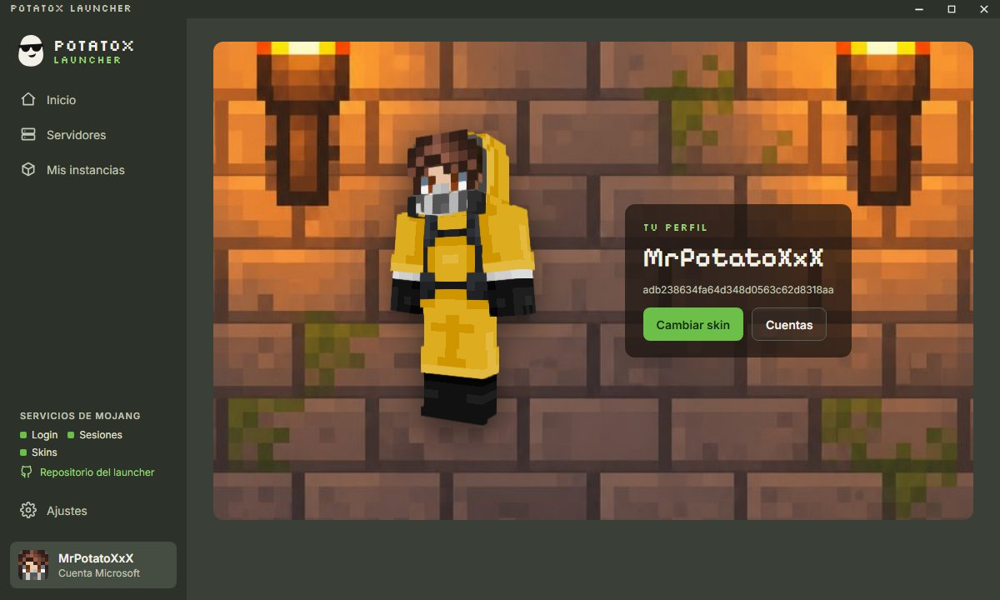

<p align="center"></p>

<h1 align="center">Potatox Launcher</h1>

<p align="center">El launcher de Minecraft del Potato para sus amigos: sus servidores y tus propias instancias, en un solo lugar.</p>

---

Potatox Launcher sirve para dos cosas:

1. **Jugar en los servidores del Potato.** Eliges el servidor y aprietas **Jugar**: el launcher instala Java, Minecraft, el loader y todos los mods y configuraciones, y los mantiene sincronizados con el servidor. Si el modpack cambia, se actualiza solo.
2. **Crear tus propias instancias** para jugar solo o con quien quieras: **Vanilla**, **Fabric**, **Forge** y **NeoForge**. Forge y NeoForge se instalan solos la primera vez que juegas (con el instalador oficial y el Java que pide esa versión).

Basado en [Helios Launcher](https://github.com/dscalzi/HeliosLauncher) (MIT).



## Funciones

* 🗂️ **Instancias en carpetas separadas.** Cada servidor y cada instancia tiene su propia carpeta, nunca dentro de `.minecraft`, así nada se mezcla ni se corrompe. Lo que es común (librerías, versiones, assets) se baja una sola vez.
* 🧩 **Mods a tu manera.** En tus instancias ves cada mod con su nombre y versión, lo activas o desactivas con un interruptor, lo borras o agregas nuevos arrastrando los `.jar` a la ventana. En los servidores ves los mods del servidor y puedes sumar tus propios mods de cliente (minimapas, shaders, rendimiento); el launcher no los toca al actualizar el modpack.
* 🔎 **Modrinth adentro.** Busca e instala mods, resource packs y shaders filtrados por la versión y el loader de cada instancia, con sus dependencias. El launcher avisa cuando un mod tiene actualización. En los servidores, el buscador muestra solo mods de cliente.
* 📦 **Compartir instancias.** Exporta una instancia a `.mrpack` (el formato de Modrinth) para pasársela a un amigo, o importa un `.mrpack` o un modpack de Modrinth y la instancia se arma sola.
* 🩹 **Ayuda cuando el juego se cae.** Si Minecraft se cierra con error, el launcher explica la causa probable (poca RAM, Java equivocado, mod incompatible, duplicado o al que le falta otro) con una sugerencia concreta, y muestra el log con buscador sin abrir herramientas raras.
* 💬 **Discord.** Tus amigos ven "Jugando Tierras Malditas" (o el nombre de tu instancia). Se apaga en Ajustes.
* 📁 **Carpetas a un clic.** Mundos, resource packs, shaders, capturas, registros y configuración.
* ⚙️ **RAM y Java por instancia.** Cada instancia tiene su memoria, su Java y sus argumentos. La RAM por defecto de las instancias nuevas se elige en Ajustes.
* ✏️ **Editar y duplicar.** Cambia el nombre, el ícono, la versión o el loader (el launcher avisa si eso puede romper tus mundos) y duplica una instancia antes de experimentar.
* ☕ **Java automático.** Si falta la versión de Java que pide Minecraft o el servidor, el launcher la instala.
* 🔒 **Cuentas de Microsoft.** Varias cuentas, inicio de sesión en la página oficial de Microsoft; el launcher no guarda tu contraseña. Tu perfil muestra la skin completa en 3D.
* 📰 **Noticias y estado.** Noticias del Potato (se abren completas), estado de cada servidor (en línea, jugadores conectados) y de los servicios de Mojang (login, sesiones y skins).
* 🌐 **Idioma.** Español o inglés.

|  |  |
| :---: | :---: |
| Vista de un servidor (Tierras Malditas) | Crear instancia |
|  |  |
| Mods de una instancia | Perfil |

## Instalar

Las versiones están en [GitHub Releases](https://github.com/MrPotatoXx/PotatoxLauncher/releases) y el launcher se actualiza solo.

| Plataforma | Archivo |
| ---------- | ------- |
| Windows x64 | [`Potatox-Launcher-setup.exe`](https://github.com/MrPotatoXx/PotatoxLauncher/releases/latest/download/Potatox-Launcher-setup.exe) |

El instalador no está firmado, así que Windows mostrará *"Windows protegió su PC"*. Para seguir: **Más información → Ejecutar de todas formas**.

## Consola

Si algo falla, la consola tiene los detalles:

```console
ctrl + shift + i
```

Abre la pestaña **Console**. Para guardar lo que muestra, haz clic derecho en la consola y elige **Save as..**

No pegues nada en la consola si no sabes exactamente qué hace: puede exponer información de tu cuenta.

## Para desarrolladores

**Requisitos:** [Node.js][nodejs] 22.

```console
> git clone https://github.com/MrPotatoXx/PotatoxLauncher.git
> cd PotatoxLauncher
> npm ci
> npm start
```

Con npm 11 o superior, `npm ci` puede bloquear el script que descarga Electron. Si `npm start` no encuentra Electron:

```console
> node node_modules/electron/install.js
```

### Lo que viene del servidor

Los servidores, las noticias y la presentación de cada servidor no están dentro del launcher: se leen de `https://mc.potatox.me/launcher/` cada vez que se abre. Se cambian en el servidor **sin publicar una versión nueva**.

| Archivo | Qué trae |
| ------- | -------- |
| `distribution.json` | Los servidores y sus mods, en el formato de Helios ([Nebula][nebula], ver [`docs/distro.md`](docs/distro.md)). El servidor puede entregar una lista distinta según quién la pida (por ejemplo, servidores de prueba solo para el admin). |
| `noticias.json` | `{ "version": 1, "noticias": [ { "id", "fecha", "titulo", "resumen", "contenido"?, "etiqueta", "imagen", "link", "servidor"? } ] }`. Al hacer clic se abre completa: `contenido` es Markdown (párrafos, **negrita**, *cursiva*, listas, títulos y links `https`; sin HTML) y si falta se muestra el `resumen`; con `link` aparece "Ver más". Inicio muestra todas; la vista de un servidor solo las que traen `"servidor": "<id>"` (las del launcher, sin `servidor`, van solo en Inicio). Con la lista vacía, la sección no se muestra. |
| `servidores-extra.json` | `{ "version": 1, "servidores": { "<id>": { … } } }` con los datos de presentación de cada servidor (abajo). Un servidor que no aparece usa valores por defecto. |

El launcher pide `distribution.json` con la cabecera `X-Potatox-Cuenta` (el UUID de la cuenta activa, con guiones), para que el servidor pueda entregarle al admin también los servidores de prueba. Sin cuenta no se manda nada, y al cambiar de cuenta se vuelve a pedir.

#### Sin conexión con el servidor

El launcher no depende de que `mc.potatox.me` esté prendido:

* Cada pedido espera como mucho 5 segundos; si no hay respuesta, sigue.
* Guarda en la carpeta de datos del launcher (`cache-servidor/`) la última copia buena de `servidores-extra.json` y `noticias.json`, y en caché los banners, íconos e imágenes de noticias; `distribution.json` queda guardado al lado, como siempre en Helios. Sin respuesta usa esas copias; sin copias, el arte que viene en el launcher (`tarjeta-generica` y el fondo de Tierras Malditas).
* Los servidores que no responden se muestran como **Apagado · sin conexión**. Inicio, Ajustes, Perfil y las instancias propias funcionan igual (Vanilla, Fabric, Forge y NeoForge se bajan de Mojang y de cada loader, no del servidor).
* Si nunca se bajó la lista de servidores y el servidor está apagado, se entra igual sin servidores; Ajustes oculta las pestañas Mods y Java del servidor.

Para probarlo en desarrollo: `POTATOX_SERVIDOR=http://10.255.255.1/launcher/ npm start` (una dirección que no responde).

### Actualizaciones del launcher

Se controlan desde este repo, no desde el servidor. Cada release lleva en `docs/release-notes.md` (el workflow lo copia al release de GitHub) una línea que dice si es obligatoria:

```markdown
<!-- obligatoria: sí -->
### Lo nuevo
- ...
```

Puede ir como comentario HTML (así no se ve en el release ni en el launcher) o como línea normal `obligatoria: sí` / `obligatoria: no`. Un release sin la línea cuenta como **no**.

Durante la pantalla de carga el launcher consulta los releases de GitHub más nuevos que la versión instalada (5 segundos como máximo):

| Caso | Qué pasa |
| ---- | -------- |
| Alguno es `obligatoria: sí` | En la misma pantalla de carga: **Actualización obligatoria** con las notas, descarga con barra de progreso, instalación y reinicio. No se entra sin actualizar. Si falla: **Reintentar** o bajar el instalador desde GitHub. |
| Todos son `obligatoria: no` | Se entra normal. Aviso discreto en la barra lateral y un toast una sola vez; se descarga en segundo plano y se instala al cerrar el launcher o al apretar **Reiniciar y actualizar**. |
| Sin internet o GitHub no responde | Se entra normal. |

Las versiones se comparan con semver.

Campos de cada servidor en `servidores-extra.json`:

| Campo | Qué hace |
| ----- | -------- |
| `loader` | `vanilla`, `fabric`, `forge` o `neoforge`, para el chip de la tarjeta. Si falta, se deduce de los módulos de la distribución. |
| `banner` / `banners` | Imagen de la tarjeta y de la vista (1280×400). Con `banners` se elige una al azar por sesión; si no, `banner`; si tampoco, una tarjeta genérica. |
| `colorAcento` | Color del borde de la tarjeta. |
| `estado` | `abierto` (se le pregunta al servidor si está en línea), `pruebas`, `proximamente` o `cerrado`. |
| `nombre`, `icono`, `version`, `descripcion` | Opcionales, para los servidores "próximamente" que todavía no están en la distribution (abajo). |
| `paneles` | Lo que muestra la vista del servidor, en orden (abajo). |

Tipos de panel:

| `tipo` | Campos | Qué muestra |
| ------ | ------ | ----------- |
| `estado` | `titulo`? | En línea o apagado, jugadores, versión, dirección y MOTD. |
| `jugadores` | `titulo`? | Cabeza y nombre de los conectados (la muestra que entrega el servidor). |
| `noticias` | `titulo`?, `max`? (4), `url`? | Noticias con el formato de `noticias.json`: las generales y las de ese servidor, o las de `url` si se indica. Se oculta si no hay. |
| `link` | `titulo`, `url`, `texto`?, `boton`? | Tarjeta con un botón que abre la URL en el navegador. |
| `texto` | `titulo`?, `texto`, `ancho`? (`"completo"`) | Texto libre (respeta los saltos de línea). |
| `tierras` | `url`? | El bloque de Tierras Malditas: tema oscuro, voz de Aldric, Prueba, fragmentos de la corona, Luna de Sangre, conectados y Crónicas (de `reino.json`). |

Un tipo que el launcher no conoce se ignora, así se pueden agregar tipos nuevos sin romper versiones viejas. Sin `paneles`, la vista muestra `estado`, `jugadores` y `noticias`.

**Servidores "próximamente".** Un servidor con `"estado": "proximamente"` en `servidores-extra.json` cuyo id no viene en la distribution de esa cuenta igual aparece en Inicio y en Servidores, con su banner, su `nombre` y la etiqueta "Próximamente", pero sin Jugar ni descargas. Su vista muestra solo los paneles `texto`, `link` y `noticias`, sin pestañas de Mods ni Carpetas. Si el id sí viene en la distribution (por ejemplo, para el admin), funciona normal.

**Cuentas sin servidores.** Si la distribution no trae ningún servidor para esa cuenta (y no hay "próximamente"), Inicio no muestra el bloque de servidores y todo lo demás funciona igual.

**Discord.** El Rich Presence usa la app "Potatox Launcher" del Developer Portal de Discord. Su Application ID viene dentro del launcher (`CLIENT_ID_POR_DEFECTO` en `app/assets/js/discordwrapper.js`). Si `distribution.json` trae `"discord": { "clientId": "…" }`, se usa ese, así se puede cambiar sin publicar versión; si no lo trae o no se pudo descargar, se usa el de adentro. La imagen grande es el Art Asset `icono` (el ícono del launcher, subido en Rich Presence → Art Assets). Un servidor puede traer su propio arte con `"discord": { "largeImageKey": "<clave>", "largeImageText": "…"? }` dentro de su entrada en `servers`: la clave tiene que existir en Art Assets, y el ícono del launcher pasa a la esquina. Las instancias propias usan siempre `icono`.

**Modrinth.** El launcher usa la API pública (`https://api.modrinth.com/v2`, sin clave) con el User-Agent `Potatox-Launcher/<versión> (github.com/MrPotatoXx/PotatoxLauncher)` y respeta el rate limit (espera lo que indica Modrinth antes de reintentar).

### Dónde está cada cosa

| Qué | Dónde |
| --- | ----- |
| URL del servidor, timeouts y caché sin conexión | `app/assets/js/servidor.js` (la distribution en `distromanager.js`) |
| Vista principal, paneles y edición de instancias | `app/landing.ejs`, `app/assets/js/scripts/inicio.js` |
| Instancias propias y loaders | `app/assets/js/instancias.js` (descargas en `instanciasworker.js`, mods en `modsjar.js`, instalador de Forge y NeoForge en `instaladorforge.js`, que también usa Tierras Malditas) |
| Bloque de Tierras Malditas | `app/assets/js/scripts/reino.js`, `ambiente.js` y `app/assets/css/reino.css` |
| Modrinth y .mrpack | `app/assets/js/modrinth.js`, `mrpack.js` y `scripts/modrinthui.js` |
| Ayuda cuando el juego se cae, visor de logs y Discord | `app/assets/js/diagnostico.js`, `registro.js` (logs del launcher en `<userData>/logs`), `discordwrapper.js` y `scripts/ayuda.js` |
| Noticias (Markdown seguro) | `app/assets/js/markdown.js` |
| Actualizaciones obligatorias y opcionales | `app/assets/js/scripts/actualizacion.js` (eventos de electron-updater en `index.js` y `uicore.js`) |
| ID de la app de Microsoft | `app/assets/js/ipcconstants.js` → `AZURE_CLIENT_ID` |
| Textos | `app/assets/lang/es_ES.toml` y `en_US.toml`; título y bienvenida en `_custom.toml` |
| Estilos | `app/assets/css/potato.css` (sobre `launcher.css` de Helios) |
| Arte, mascotas e ícono | `app/assets/images/potato/` y `build/icon.png`, `icon.ico`, `icon.icns` |

### Instaladores

| Plataforma  | Comando              |
| ----------- | -------------------- |
| Windows x64 | `npm run dist:win`   |
| macOS       | `npm run dist:mac`   |
| Linux x64   | `npm run dist:linux` |

El resultado queda en `dist/`. Los builds de macOS no suelen funcionar desde Windows o Linux, ni al revés. La configuración de Microsoft está en [`docs/MicrosoftAuth.md`](docs/MicrosoftAuth.md).

## Créditos

Potatox Launcher es un fork de [Helios Launcher](https://github.com/dscalzi/HeliosLauncher), de Daniel Scalzi, bajo licencia [MIT](LICENSE.txt). Gracias por hacerlo libre.

**NO ES UN PRODUCTO OFICIAL DE MINECRAFT. NO ESTÁ APROBADO NI ASOCIADO CON MOJANG NI MICROSOFT.**

[nodejs]: https://nodejs.org/ 'Node.js'
[nebula]: https://github.com/dscalzi/Nebula 'dscalzi/Nebula'
